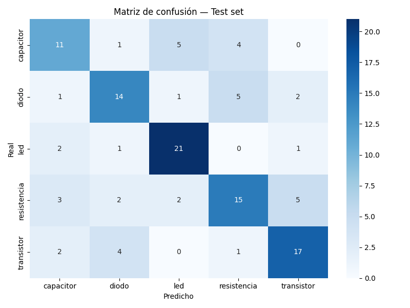
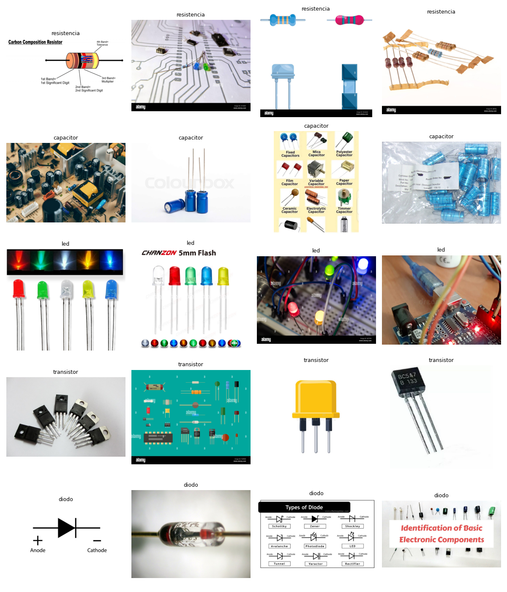

# Electronic Components ML

Modelo de Machine Learning para reconocer componentes electronicos usando Transfer Learning con EfficientNetB0 y TensorFlow.

## Demo

## Componentes detectados

| Componente | Precision |
|------------|-----------|
| LED | 84% |
| Transistor | 71% |
| Diodo | 64% |
| Resistencia | 60% |
| Capacitor | 58% |

Precision global: 65% con 787 imagenes sin GPU.

## Tecnologias

- Python 3.13 / TensorFlow 2.21 / EfficientNetB0
- OpenCV / Gradio / JupyterLab / scikit-learn

## Como ejecutarlo

1. Clonar: git clone https://github.com/MariaLuna15/electronic-components-ml.git
2. Crear entorno: python3 -m venv entorno
3. Activar: source entorno/bin/activate
4. Instalar: pip install tensorflow opencv-python pillow icrawler matplotlib scikit-learn jupyterlab gradio seaborn
5. Ejecutar: jupyter lab
6. Correr notebooks en orden: 01_dataset, 02_modelo, 03_demo

## Arquitectura del modelo

- Base: EfficientNetB0 preentrenado en ImageNet
- Capas: GlobalAveragePooling2D, Dropout, Dense(128), Dense(5)
- Optimizador: Adam lr=0.0005
- Fine-tuning: ultimas 20 capas con lr=0.00005

## Resultados

- Train accuracy: 85%
- Validation accuracy: 70%
- Test accuracy: 65%

## Autora

Maria Luna - https://github.com/MariaLuna15
